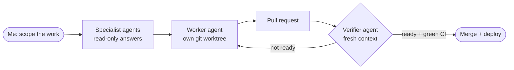

### Narcis-Eusebiu Morong

 

---

### 🛠️ What I work with

Backend and APIs, web and mobile apps, geospatial and satellite data, document and AI pipelines (Claude API, local models with MLX), and the platform around them: tunnels, access control, CI and deploys.

### 🤖 How I work with AI agents

I use Claude Code as a coordinator, not just an autocomplete. Every change goes through the same loop:

> [!IMPORTANT]
> Agents write and check the code. A human decides what ships.

<b>The rules that keep it safe on production hardware</b>

- Worktrees only, never edit a production checkout.
- No merge without a verifier saying ready and a green CI gate.
- No secrets in agent sandboxes.
- Production writes only after a dry run, a backup and my approval.
- Cheaper models do routine work; the strongest model is kept for design, root-cause and security questions.

### 🎯 What I care about

- **Access control and audit trails:** roles, invitations, rate limits, soft deletes with a grace period.
- **Reliable deploys:** fewer restarts, quiet retries in the client, a path to zero downtime.
- **Data honesty:** every number on a screen is real data, and its label describes it.
- **Clear hand-offs** between humans and agents.

<!--
morong34/morong34 is a ✨ special ✨ repository because its `README.md` (this file) appears on your GitHub profile.
-->
